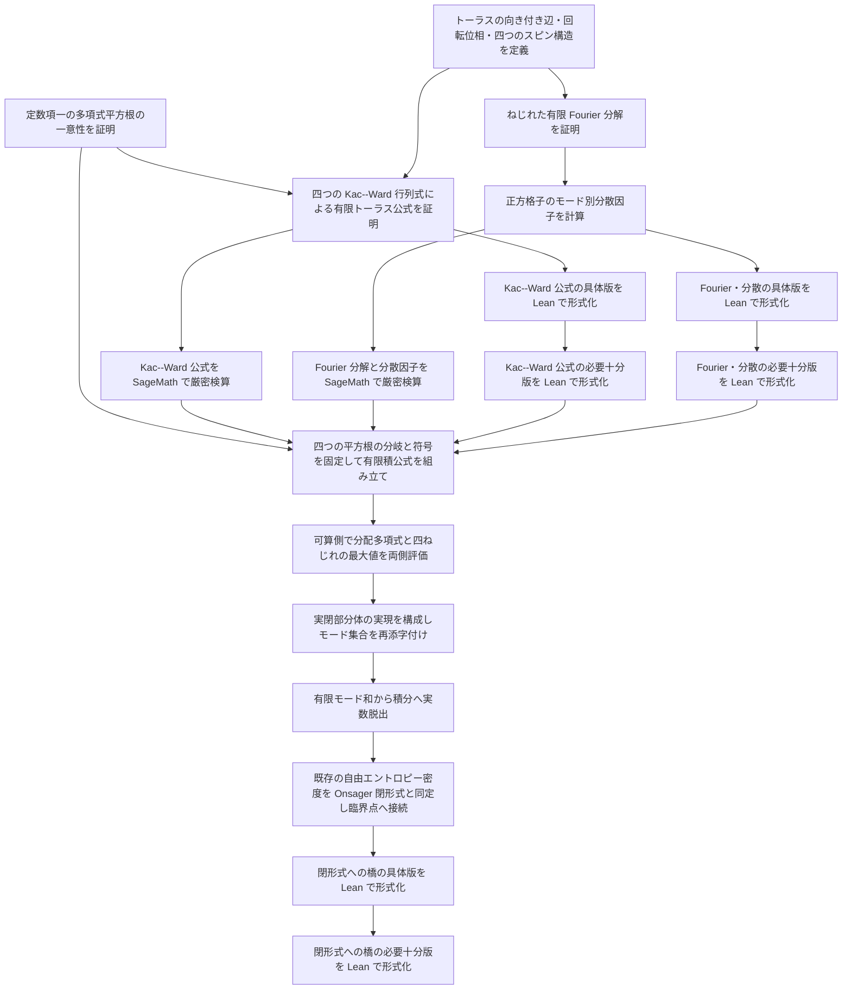

# Onsager 閉形式への接続 — Task Dependency Graph

平方根の対象は有限多項式に限定する。先に台帳の「定数項一の多項式平方根と一意性」で旧形式級数の可算性の誤記と依存を除く。平方根の存在は Kac--Ward の平方恒等式と軌道ごとの明示積が証人を与え、一意性だけをこの道具から引く。

## 概要

- **スコープ**: `onsager-closed-form-connection`
- **タイトル**: 有限トーラスの分配多項式から Onsager 閉形式までの可算的導出
- **概要**: 既存の分配多項式・高温展開・巻き付きセクター・熱力学極限を出発点に、トーラス上の四つの Kac--Ward 行列式、有限 Fourier 因数分解、分散因子、Riemann 和の極限を順に証明し、既存の周期境界自由エントロピー密度を Onsager 積分表示と同定する。有限系の全段は円分体を含む可算な代数世界に置き、実現写像の存在を可算側の上下界から証明し、実数・複素数への脱出を実現写像・実対数・角への指数評価・連続極限の各段で明示する。

## 依存状況

- `def_partition_polynomial`, `theorem_partition_polynomial_is_trace`: 完了
- `claim_high_temperature_polynomial_identity`, `claim_high_temperature_sector_decomposition`: 完了
- `claim_low_temperature_trivial_sector_expression`, `claim_sector_value_duality`: 完了
- `def_kw_dual_transform`, `claim_kw_self_dual_quadratic_equivalence`, `def_critical_point`: 完了
- `def_periodic_free_energy_density_le_one`: 完了
- トーラス版 Kac--Ward 公式: 反対称化と行列式保存まで完了、Pfaffian 平方恒等式以降は未完了。有限 Fourier 分解、Onsager 閉形式との同定: 未着手

## 採用する経路と出典

- 分配多項式を表す対象は Kac--Ward 行列式である（README）。四つのスピン構造に対応する行列式の定数項一の平方根の和の半分を使う（低温変数のまま、四項とも正の符号）。正本となる外部出典は David Cimasoni, *A generalized Kac--Ward formula*, arXiv:1004.3158 と、Chelkak–Cimasoni–Kassel, *Revisiting the combinatorics of the 2D Ising model*, Ann. Inst. Henri Poincaré D 4 (2017) 309–385, arXiv:1507.08242 である。
- 平方恒等式 $D^{a,b}_L(x)=(Q^{a,b}_L(x))^2$ の証明は、反転写像の置換行列と対角相似で行列式を反対称行列へ移し、Pfaffian の平方の定理と完全マッチング展開で閉じる（Chelkak–Cimasoni–Kassel の 1.3 節・2.1–2.2 節・定理 4.2）。節の列は [proof/prove-torus-kac-ward-formula.md](proof/prove-torus-kac-ward-formula.md) にある。行列式の置換展開と偶部分グラフ対を鍵ごとに直接比較する旧経路は 2026-10-03 に打ち切った（経過は `docs/tasks/auto-loop-archive.md`）。Fisher の装飾格子や Kasteleyn の向き付け定理は使わない。
- 有限 Fourier 分解と分散因子は Kac--Ward 多項式行列の定義だけに依存し、平方恒等式の完成を待たない。台帳のセクション表では平方恒等式の節 5 の直後、離散 Whitney 系の Lean 配線の前に置く（2026-10-03 と 2026-10-08 の研究管理の決定）。採用する形（モード集合、位置を終点で取るねじれ Fourier ベクトル、$4\times4$ 小行列、分散因子 $(1+x^2)^2-x(1-x^2)(\varpi+\varpi^{-1}+\varsigma+\varsigma^{-1})$）は [proof/prove-finite-fourier-factorization.md](proof/prove-finite-fourier-factorization.md) と [proof/compute-square-lattice-dispersion-factor.md](proof/compute-square-lattice-dispersion-factor.md) にあり、辺長 1〜3 で厳密計算により確認済み（証明ではない）。
- 設計ノートは `docs/discussion/対数順序群上の統計力学/09_2DIsing閉形式の可算的導出.md` と `10_Step3の厳密化_KacWardとPfaffian.md`。後者の単一行列式の記述は平面の場合に限り、トーラスへはそのまま適用しない。

## 依存関係図

## タスク一覧

| ファイル | カテゴリ | 概要 | 依存先 | 並列可否 |
|---|---|---|---|---|
| `definition/define-torus-kac-ward-data.md` | 定義 | 向き付き辺、反転、回転位相、四つのねじれ行列 | 既存の有限トーラス | 不可 |
| `proof/prove-torus-kac-ward-formula.md` | 証明 | 分配多項式を四平方根の和の半分で表す | Kac--Ward データ・多項式平方根の一意性 | 不可 |
| `verification/verify-kac-ward-formula-with-sagemath.md` | 検算 | 小さい格子で係数ごとに厳密検算 | トーラス版公式 | 可 |
| `formalization/formalize-kac-ward-concrete-in-lean.md` | Lean 具体版 | 本文の有限和・行列式展開と一対一対応 | トーラス版公式 | 可 |
| `formalization/formalize-kac-ward-essential-in-lean.md` | Lean 必要十分版 | 公式に必要な有限組合せ構造だけを抽出 | Lean 具体版 | 不可 |
| `proof/prove-finite-fourier-factorization.md` | 証明 | 四ねじれごとの有限 Fourier ブロック対角化 | Kac--Ward データ | 不可 |
| `proof/compute-square-lattice-dispersion-factor.md` | 証明 | 小行列式を計算し分散因子を得る | Fourier 分解 | 不可 |
| `verification/verify-fourier-and-dispersion-with-sagemath.md` | 検算 | ブロック対角化と小行列式を円分体上で検算 | 分散因子 | 可 |
| `formalization/formalize-fourier-dispersion-concrete-in-lean.md` | Lean 具体版 | 本文の Fourier・小行列式計算と一対一対応 | 分散因子 | 可 |
| `formalization/formalize-fourier-dispersion-essential-in-lean.md` | Lean 必要十分版 | 有限巡回移動の指標分解に必要な仮定を抽出 | Lean 具体版 | 不可 |
| `proof/assemble-finite-volume-closed-product.md` | 証明 | 四つの平方根の分岐・符号を固定し有限積公式を得る | Kac--Ward と分散の全検証・多項式平方根の一意性 | 不可 |
| `proof/prove-twists-share-thermodynamic-limit.md` | 証明 | 可算側で最大値との両側評価を示す | 有限積公式 | 不可 |
| `proof/pass-from-mode-sums-to-integral.md` | 証明 | 実現写像の存在・モードの全単射・実対数・Riemann 和 | 有限積・正値性・両側評価 | 不可 |
| `proof/identify-onsager-closed-form-and-critical-point.md` | 証明 | 既存の極限を Onsager 積分と同定し自己双対点の特異性へ接続 | 積分極限 | 不可 |
| `formalization/formalize-closed-form-bridge-concrete-in-lean.md` | Lean 具体版 | 有限積から既存の極限対象までを本文対応で形式化 | Onsager 同定 | 不可 |
| `formalization/formalize-closed-form-bridge-essential-in-lean.md` | Lean 必要十分版 | 閉形式への接続に本質的な仮定を抽出 | Lean 具体版 | 不可 |

## 実行順序

依存関係図の上流から進める。実行の順序の正本は `docs/tasks/auto-loop-state.md` のセクション表である。SageMath と Lean の検証を後回しにして先の数学へ進めず、有限公式と分散因子の各段で四層を閉じてから有限積公式を組み立てる。
