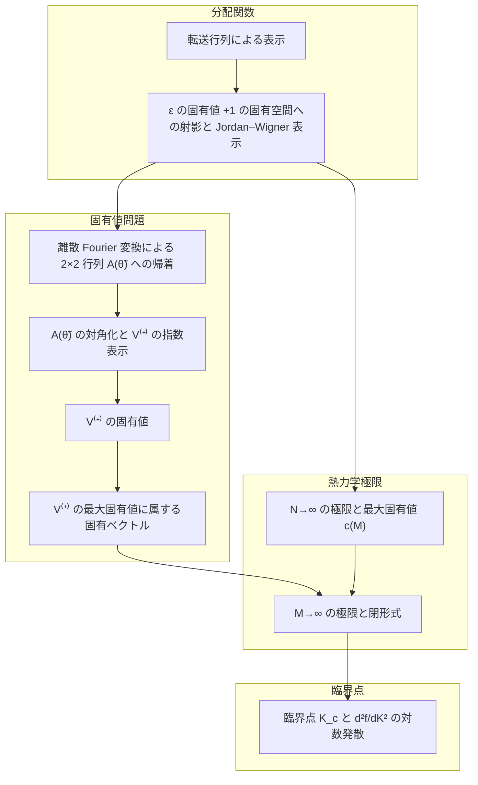

# 章立て案：分配関数、固有値問題、熱力学極限、臨界点

2026-10-31 の代表の依頼（Slack）による案である。代表が示した次の構成に、数学的道具立てを先に置いて章を並べる。

- 分配関数：転送行列による表示、$`\varepsilon`$ の固有値 $`+1`$ の固有空間への射影と Jordan–Wigner 表示
- 固有値問題：離散 Fourier 変換、対角化と指数表示、$`V^{(+)}`$ の固有値、最大固有値に属する固有ベクトル
- 熱力学極限：最大固有値、閉形式
- 臨界点

各章は一つのゴールの式で終わる。章題は、扱う対象と主張を数学の言葉で書く。
本文で定義されていない物理の用語（運動量、フェルミオン、セクターなど）は使わない。
**承認されるまで本文・構成再編の runbook・棚卸しは変えない。**

## 示された構成との照合

構成は本文の依存と矛盾しない。固有値問題の章は $`c(M)`$（下の「$`N\to\infty`$ の極限と最大固有値 $`c(M)`$」の章で
定義する上限）を使わないので、熱力学極限の部より前に置ける。示された構成の言葉と違うのは次の二点である。

- **固有値を求めるのは $`W`$ ではなく $`V^{(+)}`$ である。** $`V^{(+)}`$ は、$`W`$ を $`\varepsilon`$ の固有値 $`+1`$ の
  固有空間 $`\mathcal F^{(+)}`$ に制限したものと一致する（$`WP^{(+)}=V^{(+)}P^{(+)}`$）。$`W`$ の最大固有値 $`c(M)`$ が
  $`V^{(+)}`$ の最大固有値で上下から押さえられること（$`\Lambda^{(1/2)}_M\le c(M)\le 2\Lambda^{(1/2)}_M`$）は、熱力学極限の部で示す。
- **熱力学極限は二段である。** $`N\to\infty`$ で $`\frac{1}{MN}\log Z`$ が $`\frac1M\log c(M)`$ に収束し、
  $`M\to\infty`$ で Riemann 和が積分に収束して閉形式が出る。

## 章立て

並びは上から順である。項目数は 2026-10-31 の main の棚卸し（`docs/organization/flat-inventory.json`、
数学的道具立て 114 項・2次元イジングモデル 170 項）から数えた。

各章の「ゴールの式」は、その章が最後に示す主張である。記号は本文のものをそのまま使う
（$`M:=M_{\mathrm{col}}`$、$`N:=N_{\mathrm{row}}`$ と略記する。$`T_{(V)}(X):=VXV^{-1}`$ は共役写像）。

### 数学的道具立て

- 項目数: 道具 114
- 主な中身: 現行の道具章

### 分配関数

#### 転送行列による表示

- 項目数: 20
- 主な中身: 001、004 の Pauli 表示と双対結合定数
- ゴールの式:

```math
Z=\mathrm{tr}\left((V_1V_2)^{N}\right),\qquad
V_1=\exp\left(K_1\sum_{m=1}^{M}\sigma^z_m\sigma^z_{m+1}\right),\qquad
V_2=(2\sinh 2K_2)^{M/2}\exp\left(K_2^*\sum_{m=1}^{M}\sigma^x_m\right)
```

#### $`\varepsilon`$ の固有値 $`+1`$ の固有空間への射影と Jordan–Wigner 表示

- 項目数: 27
- 主な中身: 004 の Jordan–Wigner 行列族・$`\varepsilon`$・$`H_1^{(+)},H_2`$、009、010
- ゴールの式:

```math
WP^{(+)}=V^{(+)}P^{(+)},\qquad
P^{(+)}=\tfrac12\left(I+\varepsilon\right),\qquad
\varepsilon=\sigma^x_1\cdots\sigma^x_M,\qquad
\mathcal F^{(+)}=\left\{x\in\mathbb C^{2^M}\ \middle|\ \varepsilon x=x\right\}=\mathrm{im}\,P^{(+)},
```

```math
V^{(+)}=\exp\left(\tfrac{i}{2}K_1H_1^{(+)}\right)\,(2\sinh 2K_2)^{M/2}\exp\left(iK_2^*H_2\right)\,\exp\left(\tfrac{i}{2}K_1H_1^{(+)}\right),
```

```math
H_1^{(+)}=\sum_{m=1}^{M-1}Y_mZ_{m+1}-Y_MZ_1,\qquad
H_2=\sum_{m=1}^{M}Z_mY_m
```

### 固有値問題

#### 離散 Fourier 変換による $`2\times2`$ 行列 $`A(\tilde\theta_\mu)`$ への帰着

- 項目数: 27
- 主な中身: 006、008、013、014
- ゴールの式（$`\mu\in\check{\mathcal M}=\{1,\dots,M\}`$）:

```math
\tilde\theta_\mu=\frac{2\pi\left(\mu-\tfrac12\right)}{M},\qquad
\check Z_\mu=\sum_{j=1}^{M}Z_j\exp(-ij\tilde\theta_\mu),\qquad
\check Y_\mu=\sum_{j=1}^{M}Y_j\exp(-ij\tilde\theta_\mu),
```

```math
\left(T_{(V^{(+)})}(\check Z_\mu),\ T_{(V^{(+)})}(\check Y_\mu)\right)=\left(\check Z_\mu,\ \check Y_\mu\right)A(\tilde\theta_\mu),\qquad
A(\theta)=B_1(\theta)\,B_2\,B_1(\theta)
```

#### $`A(\tilde\theta_\mu)`$ の対角化と $`V^{(+)}`$ の指数表示

- 項目数: 27
- 主な中身: 015、016
- ゴールの式（$`\mu\in\check{\mathcal M}`$。$`\check P_\mu\in\mathrm{Mat}(2,\mathbb C)`$ は本文で成分を与える可逆行列。$`c\in\mathbb C^\times`$ の値は次の章で決める）:

```math
A(\tilde\theta_\mu)=\check P_\mu\begin{pmatrix}\lambda_{+,\mu}&0\\0&\lambda_{-,\mu}\end{pmatrix}\check P_\mu^{-1},\qquad
\lambda_{\pm,\mu}=\exp\left(\pm\gamma(\tilde\theta_\mu)\right),
```

```math
\gamma(\theta)=\mathrm{arccosh}\left(\cosh 2K_1\cosh 2K_2^*-\sinh 2K_1\sinh 2K_2^*\cos\theta\right),
```

```math
\left(\check\psi_\mu^\dagger,\ \check\psi_\mu\right)=\left(\check Z_\mu,\ \check Y_\mu\right)\check P_\mu,\qquad
\check n_\mu=\check\psi_\mu^\dagger\check\psi_{M+1-\mu},
```

```math
V^{(+)}=c\,\exp\left(\sum_{\mu\in\check{\mathcal M}}\gamma(\tilde\theta_\mu)\left(\check n_\mu-\tfrac12I\right)\right)
```

#### $`V^{(+)}`$ の固有値

- 項目数: 15
- 主な中身: 017
- ゴールの式（$`\epsilon\in\{0,1\}^{\check{\mathcal M}}`$）:

```math
c=(2\sinh 2K_2)^{M/2},\qquad
\check Q_\epsilon=\prod_{\mu=1}^{M}\left(\epsilon_\mu\check n_\mu+(1-\epsilon_\mu)\left(I-\check n_\mu\right)\right),\qquad
V^{(+)}\check Q_\epsilon=\check\Lambda_\epsilon\check Q_\epsilon,
```

```math
\check\Lambda_\epsilon=(2\sinh 2K_2)^{M/2}\exp\left(\sum_{\mu=1}^{M}\gamma(\tilde\theta_\mu)\left(\epsilon_\mu-\tfrac12\right)\right),
```

```math
\max_\epsilon\check\Lambda_\epsilon=\check\Lambda_{(1,\dots,1)}=\Lambda^{(1/2)}_M=(2\sinh 2K_2)^{M/2}\exp\left(\frac12\sum_{\mu=1}^{M}\gamma(\tilde\theta_\mu)\right),\qquad
\epsilon\neq(1,\dots,1)\Longrightarrow\check\Lambda_\epsilon<\check\Lambda_{(1,\dots,1)}
```

#### $`V^{(+)}`$ の最大固有値に属する固有ベクトル

- 項目数: 17
- 主な中身: 018 の前半（スピン配置の和による $`\mathrm{tr}(\varepsilon V^{(+)})`$ の計算）
- ゴールの式:

```math
\mathrm{tr}\left(\varepsilon V^{(+)}\right)=\left(2\exp(-K_2)\cosh K_1\right)^{M}+\left(2\exp(K_2)\sinh K_1\right)^{M}>0
\ \Longrightarrow\
\mathrm{im}\,\check Q_{(1,\dots,1)}\subseteq\mathcal F^{(+)}
```

### 熱力学極限

#### $`N\to\infty`$ の極限と最大固有値 $`c(M)`$

- 項目数: 9
- 主な中身: 011 の $`W`$・Rayleigh 上限・トレース評価、012
- ゴールの式:

```math
W=V_1^{1/2}V_2V_1^{1/2},\qquad
c(M)=\sup\left\{x^\top Wx\ \middle|\ x\in\mathbb R^{2^M},\ \lVert x\rVert=1\right\},
```

```math
c(M)^{N}\le Z\le 2^{M}c(M)^{N},\qquad
\lim_{N\to\infty}\frac{1}{MN}\log Z=\frac1M\log c(M)
```

#### $`M\to\infty`$ の極限と閉形式

- 項目数: 9
- 主な中身: 011 の $`c_+(M)`$、012 の Riemann 和と閉形式、018 の結論
- ゴールの式:

```math
c_+(M)=\sup\left\{x^\top Wx\ \middle|\ x\in\mathcal F^{(+)}\cap\mathbb R^{2^M},\ \lVert x\rVert=1\right\}=\Lambda^{(1/2)}_M,\qquad
\Lambda^{(1/2)}_M\le c(M)\le 2\Lambda^{(1/2)}_M,
```

```math
\lim_{M\to\infty}\lim_{N\to\infty}\frac{1}{MN}\log Z
=\frac12\log\left(2\sinh 2K_2\right)+\frac1{4\pi}\int_0^{2\pi}\gamma(\theta)\,d\theta
```

### 臨界点

#### 臨界点 $`K_c`$ と $`\frac{d^2f}{dK^2}`$ の対数発散

- 項目数: 10
- 主な中身: 008 の臨界条件、020
- ゴールの式（$`K_1=K_2=K`$、$`f(K)`$ は上の極限の右辺、$`0<\lvert K-K_c\rvert\le\frac1{10}`$）:

```math
\sinh 2K_c=1,\qquad
\left\lvert\frac{d^2f}{dK^2}(K)-\frac{8}{\pi}\log\frac{1}{\lvert K-K_c\rvert}\right\rvert\le 49
```

## 章の依存関係

枠は部を、矢印は「矢印の元の章を、矢印の先の章が使う」を表す。棚卸しの依存ラベルから章どうしの直接の参照を集め
（$`\Lambda^{(\delta)}`$ の定義は分離を済ませた前提）、ほかの矢印を辿って届く矢印は省いた。
数学的道具立てはすべての章が使うので、図から省いた。



> 2026-10-31 の照合（構成再編の runbook の「作業の順序」の六番目）で、本文の説明ページの図は本文の依存に合わせ、
> `proj --> rowlim` を `eig --> rowlim` に替えた。$`N\to\infty`$ の極限の章の $`W`$ の実対称性・正定値性の証明が、
> $`V^{(+)}`$ の固有値の章の $`iK_1H_1^{(+)}, iK_2^*H_2`$ の実対称性を使うためである。上の図と下の説明は承認時のまま残す。

図から読めること:

- 後ろの章から前の章への依存は無い。並びのとおりに読めば、前方参照は起きない。
- $`\varepsilon`$ の固有値 $`+1`$ の固有空間への射影と Jordan–Wigner 表示の章のあとで流れが二つに分かれる。固有値問題の四章と、$`N\to\infty`$ の極限の章である。
  二つの流れは $`M\to\infty`$ の極限の章で合流する。

### 振り分けの決め方

各章のゴールの式について、棚卸しの依存ラベルを辿った依存閉包を、上の章から順に取った。
まだどの章にも入っていない項を、その章に入れた。したがって各章は、それより前の章と数学的道具立てだけを使う。

## 組み直すのに要る本文の変更

- **$`\Lambda^{(\delta)}_{M}`$ の定義を、閉形式の定理（`onsager_free_energy_expression`）から独立した定義に分ける。**
  いまは定理の statement の中で定義しており、$`V^{(+)}`$ の最大固有値の定理
  （`max_eigenvalue_of_V_plus_simple`）が、この定義を使うためだけに閉形式の定理を参照している。
  このままだと固有値問題の章が熱力学極限の部の章に依存する。上の項目数は、この分離を済ませた前提で数えた。
- **本文の題から、定義されていない物理の用語を除く。** いま本文の章題・ブロック題 16 件が
  「偶セクター」「半整数運動量」「フェルミオン」を含む（例：$`\check\psi_\mu`$ の定義の題
  「半整数運動量のフェルミオン」、$`\check{\mathcal M}`$ の定義の題「半整数運動量の添字集合」、
  $`V^{(+)}`$ の定義の題「偶セクターの転送行列」）。組み直しのときに、対象を式で表す題へ直す。

## 残る点

- どの章のゴールの式からも辿れない項が 9 つある：Jordan–Wigner 行列の線型独立性、
  $`\varepsilon`$ の固有空間の部分線型空間性（2 項）、$`\varepsilon`$ の作用の固有値候補、
  $`(V_1^{(+)})^{1/2}`$ の平方根性、$`\check Z,\check Y`$ による $`H_1^{(+)},H_2`$ の表示、
  $`(V^{(+)})^{-1}`$ の正定値性とトレース正値性（2 項）、$`\check n_\mu`$ のエルミート性。
  参照用ノートへ退避するかを、組み直しのときに一つずつ確かめる。
- 構成再編の runbook のゴール「最終章を数学的道具立てと 2次元イジングモデルの二章だけにする」を、
  この章立てに改める。承認されたら runbook・棚卸しの生成器・節境界を更新する。
