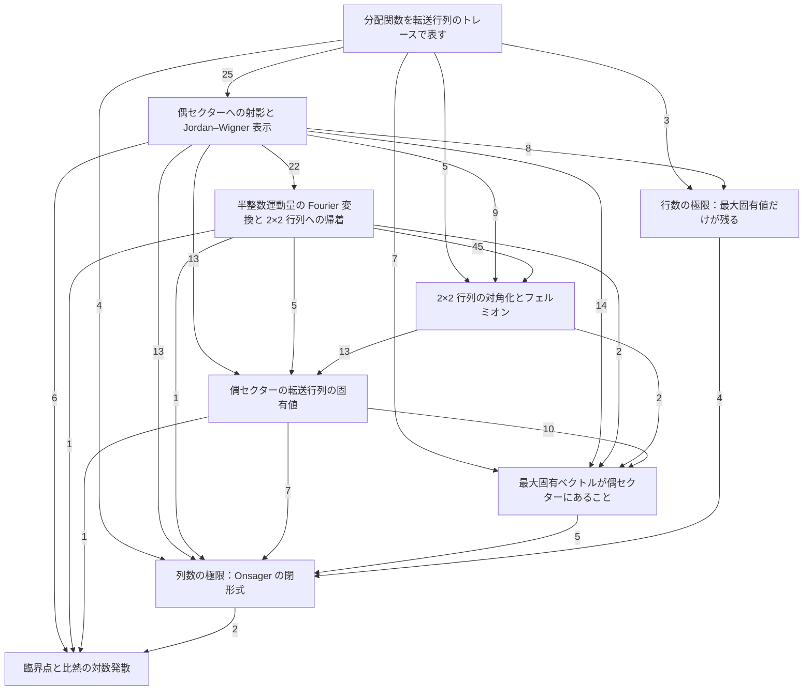

# 章立て案：トレース、固有値問題、極限、臨界点

2026-10-31 の代表の依頼（Slack）による案である。最初の案（注意「厳密解へ残っている入力：偶セクターの固有値」の
五段階で切る案）は、章ごとの項目数の偏りが大きく退けられた。この案は、代表が示した
「分配関数を行列のトレースで表す → 行列の固有値問題を解く → 極限で最大固有値だけが残り閉形式が出る → 臨界点」
の順に、数学的道具立ての後ろへ章を並べる。各章は一つのゴールの式で終わる。
**承認されるまで本文・構成再編の runbook・棚卸しは変えない。**

## 示された順序との照合

順序は本文の依存と矛盾しない。固有値問題の章は挟み撃ち（Rayleigh 上限 $c(M_{\mathrm{col}})$）を使わないので、
極限の章より前に置ける。ただし次の二点が、示された順序の言葉と違う。

- **解く固有値問題は全体の転送行列ではなく、偶セクターの転送行列 $V^{(+)}$ だけである。**
  全体の最大固有値が偶セクターの最大固有値で押さえられること（$c_+\le c\le 2c_+$）は、極限の章で示す。
- **極限は二段である。** 行数 $N_{\mathrm{row}}\to\infty$ で最大固有値だけが残り（挟み撃ち）、
  列数 $M_{\mathrm{col}}\to\infty$ で Riemann 和が積分になって閉形式が出る。

## 章立て

並びは上から順である。項目数は 2026-10-31 の main の棚卸し（`docs/organization/flat-inventory.json`、
数学的道具立て 114 項・2次元イジングモデル 170 項）から数えた。

各章の「ゴールの式」は、その章が最後に示す主張である。記号は本文のものをそのまま使う
（$M:=M_{\mathrm{col}}$、$N:=N_{\mathrm{row}}$ と略記する。$T_{(V)}(X):=VXV^{-1}$ は共役写像）。

### 数学的道具立て

- 項目数: 道具 114
- 主な中身: 現行の道具章

### 分配関数を転送行列のトレースで表す（トレースの部）

- 項目数: 20
- 主な中身: 001、004 の Pauli 表示と双対結合定数
- ゴールの式:

$$
Z=\mathrm{tr}\left((V_1V_2)^{N}\right),\qquad
V_1=\exp\left(K_1\sum_{m=1}^{M}\sigma^z_m\sigma^z_{m+1}\right),\qquad
V_2=(2\sinh 2K_2)^{M/2}\exp\left(K_2^*\sum_{m=1}^{M}\sigma^x_m\right)
$$

### 偶セクターへの射影と Jordan–Wigner 表示（固有値問題の部）

- 項目数: 27
- 主な中身: 004 の Jordan–Wigner・全スピン反転・一般生成子、009、010
- ゴールの式:

$$
WP^{(+)}=V^{(+)}P^{(+)},\qquad P^{(+)}=\tfrac12\left(I+\varepsilon\right),\qquad
\varepsilon=\sigma^x_1\cdots\sigma^x_M,
$$

$$
V^{(+)}=\exp\left(\tfrac{i}{2}K_1H_1^{(+)}\right)\,(2\sinh 2K_2)^{M/2}\exp\left(iK_2^*H_2\right)\,\exp\left(\tfrac{i}{2}K_1H_1^{(+)}\right),
$$

$$
H_1^{(+)}=\sum_{m=1}^{M-1}Y_mZ_{m+1}-Y_MZ_1,\qquad
H_2=\sum_{m=1}^{M}Z_mY_m
$$

### 半整数運動量の Fourier 変換と 2×2 行列への帰着（固有値問題の部）

- 項目数: 27
- 主な中身: 006、008、013、014
- ゴールの式（$\mu\in\check{\mathcal M}$）:

$$
\left(T_{(V^{(+)})}(\check Z_\mu),\ T_{(V^{(+)})}(\check Y_\mu)\right)=\left(\check Z_\mu,\ \check Y_\mu\right)A(\tilde\theta_\mu),\qquad
A(\theta)=B_1(\theta)\,B_2\,B_1(\theta),
$$

$$
\check Z_\mu=\sum_{j=1}^{M}Z_j\exp(-ij\tilde\theta_\mu),\qquad
\check Y_\mu=\sum_{j=1}^{M}Y_j\exp(-ij\tilde\theta_\mu),\qquad
\tilde\theta_\mu=\frac{2\pi\left(\mu-\tfrac12\right)}{M}
$$

### 2×2 行列の対角化とフェルミオン（固有値問題の部）

- 項目数: 27
- 主な中身: 015、016
- ゴールの式（$\mu\in\check{\mathcal M}$、ある $c\in\mathbb C^\times$）:

$$
\det\left(A(\tilde\theta_\mu)-\lambda_{\pm,\mu}I_2\right)=0,\qquad\lambda_{\pm,\mu}=\exp\left(\pm\gamma(\tilde\theta_\mu)\right),
$$

$$
\gamma(\theta)=\mathrm{arccosh}\left(\cosh 2K_1\cosh 2K_2^*-\sinh 2K_1\sinh 2K_2^*\cos\theta\right),
$$

$$
V^{(+)}=c\,\exp\left(\sum_{\mu\in\check{\mathcal M}}\gamma(\tilde\theta_\mu)\left(\check\psi_\mu^\dagger\check\psi_{M+1-\mu}-\tfrac12I\right)\right)
$$

### 偶セクターの転送行列の固有値（固有値問題の部）

- 項目数: 15
- 主な中身: 017
- ゴールの式（$\epsilon\in\{0,1\}^{\check{\mathcal M}}$）:

$$
V^{(+)}\check Q_\epsilon=\check\Lambda_\epsilon\check Q_\epsilon,\qquad
\check\Lambda_\epsilon=(2\sinh 2K_2)^{M/2}\exp\left(\sum_{\mu=1}^{M}\gamma(\tilde\theta_\mu)\left(\epsilon_\mu-\tfrac12\right)\right),
$$

$$
\max_\epsilon\check\Lambda_\epsilon=\check\Lambda_{(1,\dots,1)}=\Lambda^{(1/2)}_M=(2\sinh 2K_2)^{M/2}\exp\left(\frac12\sum_{\mu=1}^{M}\gamma(\tilde\theta_\mu)\right),\qquad
\epsilon\neq(1,\dots,1)\Longrightarrow\check\Lambda_\epsilon<\check\Lambda_{(1,\dots,1)}
$$

### 最大固有ベクトルが偶セクターにあること（固有値問題の部）

- 項目数: 17
- 主な中身: 018 の前半、1次元開鎖のスピン和
- ゴールの式（$\mathcal F^{(+)}=\{x\in\mathbb C^{2^M}\mid\varepsilon x=x\}$）:

$$
\mathrm{tr}\left(\varepsilon V^{(+)}\right)=\left(2\exp(-K_2)\cosh K_1\right)^{M}+\left(2\exp(K_2)\sinh K_1\right)^{M}>0
\ \Longrightarrow\
\mathrm{im}\,\check Q_{(1,\dots,1)}\subseteq\mathcal F^{(+)}
$$

### 行数の極限：最大固有値だけが残る（極限の部）

- 項目数: 9
- 主な中身: 011 の $W$・Rayleigh 上限・トレース評価、012
- ゴールの式:

$$
c(M)=\sup\left\{x^\top Wx\ \middle|\ x\in\mathbb R^{2^M},\ \lVert x\rVert=1\right\},\qquad
c(M)^{N}\le Z\le 2^{M}c(M)^{N},\qquad
\lim_{N\to\infty}\frac{1}{MN}\log Z=\frac1M\log c(M)
$$

### 列数の極限：Onsager の閉形式（極限の部）

- 項目数: 9
- 主な中身: 011 のセクター上限、012 の Riemann 和と Onsager の表式、018 の厳密解
- ゴールの式:

$$
c_+(M)=\sup\left\{x^\top Wx\ \middle|\ x\in\mathcal F^{(+)}\cap\mathbb R^{2^M},\ \lVert x\rVert=1\right\}=\Lambda^{(1/2)}_M,\qquad
\Lambda^{(1/2)}_M\le c(M)\le 2\Lambda^{(1/2)}_M,
$$

$$
\lim_{M\to\infty}\lim_{N\to\infty}\frac{1}{MN}\log Z
=\frac12\log\left(2\sinh 2K_2\right)+\frac1{4\pi}\int_0^{2\pi}\gamma(\theta)\,d\theta
$$

### 臨界点と比熱の対数発散（臨界点の部）

- 項目数: 10
- 主な中身: 008 の臨界条件、020
- ゴールの式（$K_1=K_2=K$、$f(K)$ は上の極限の右辺、$0<\lvert K-K_c\rvert\le\frac1{10}$）:

$$
\sinh 2K_c=1,\qquad
\left\lvert\frac{d^2f}{dK^2}(K)-\frac{8}{\pi}\log\frac{1}{\lvert K-K_c\rvert}\right\rvert\le 49
$$

## 章の依存関係

矢印は「矢印の元の章を、矢印の先の章が使う」を表す。矢印に添えた数は、先の章の項目が元の章の項目を
直接参照している件数である（棚卸しの依存ラベルから数えた。$\Lambda^{(\delta)}$ の定義は分離を済ませた前提）。
数学的道具立てはすべての章が使うので、図から省いた。

図から読めること:

- 後ろの章から前の章への矢印は無い。並びのとおりに読めば、前方参照は起きない。
- 行数の極限の章は、トレースの章と偶セクターへの射影の章だけを使う。固有値問題の後半の四章とは独立で、
  二つの流れは列数の極限の章で合流する。
- 最も太い依存は、Fourier 変換の章から対角化の章への 45 件である。

### 振り分けの決め方

各章のゴールの式について、棚卸しの依存ラベルを辿った依存閉包を、上の章から順に取った。
まだどの章にも入っていない項を、その章に入れた。したがって各章は、それより前の章と数学的道具立てだけを使う。

## 組み直すのに要る本文の変更

- **$\Lambda^{(\delta)}_{M_{\mathrm{col}}}$ の定義を、Onsager の表式の定理から独立した定義に分ける。**
  いまは定理の statement の中で定義しており、偶セクターの最大固有値の定理
  （`max_eigenvalue_of_V_plus_simple`）が、この定義を使うためだけに Onsager の表式の定理を参照している。
  このままだと固有値の章が極限の章に依存する。上の項目数は、この分離を済ませた前提で数えた。

最初の案で挙げた「挟み撃ちの章から Jordan–Wigner を外す証明の差し替え」は、この順序では要らない。
Jordan–Wigner の章が挟み撃ちの章より前に来るためである。

## 残る点

- どの章のゴールの式からも辿れない項が 9 つある：Jordan–Wigner 行列の線型独立性、
  $\varepsilon$ の固有空間の部分線型空間性（2 項）、$\varepsilon$ の作用の固有値候補、
  $(V_1^{(+)})^{1/2}$ の平方根性、$\check Z,\check Y$ による $H_1^{(+)},H_2$ の表示、
  $(V^{(+)})^{-1}$ の正定値性とトレース正値性（2 項）、$\check n_\mu$ のエルミート性。
  参照用ノートへ退避するかを、組み直しのときに一つずつ確かめる。
- 構成再編の runbook のゴール「最終章を数学的道具立てと 2次元イジングモデルの二章だけにする」を、
  この章立てに改める。承認されたら runbook・棚卸しの生成器・節境界を更新する。
